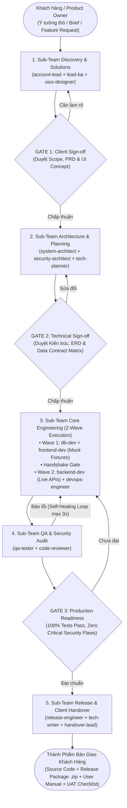

# AI-Vibe-Coding: Công Ty Phát Triển Phần Mềm AI Toàn Năng Trên Antigravity 2.0

**AI-Vibe-Coding** là template kiến trúc mẫu chuyển hóa môi trường làm việc của bạn thành một **Công ty Phát triển Phần mềm AI Toàn Năng (AI Software House)** vận hành khép kín trên nền tảng **Antigravity 2.0**.

Template mô phỏng trọn vẹn quy trình Agency / Software House chuyên nghiệp: từ khâu tiếp nhận yêu cầu thô từ Khách hàng $\rightarrow$ Phỏng vấn nghiệp vụ $\rightarrow$ Xuất bản PRD & UI/UX Concept $\rightarrow$ Thiết kế Kiến trúc & Hợp đồng Dữ liệu $\rightarrow$ Lập trình Đợt kép (2-Wave Dev) $\rightarrow$ Kiểm thử Tự động 5 tầng $\rightarrow$ Thẩm định Chất lượng Code & Bảo mật $\rightarrow$ Tự sửa lỗi (Self-Healing Loop) $\rightarrow$ Đóng gói & Bàn giao Sản phẩm hoàn chỉnh.

---

## 🏛️ Sơ Đồ Vận Hành 5 Sub-Teams (15 Subagents)



---

## 👥 Danh Sách 5 Sub-Teams & 15 Subagents Chuyên Trách

| Sub-Team | Subagent ID | Vai trò chính | Model Tier | Thư mục quyền sở hữu |
| :--- | :--- | :--- | :--- | :--- |
| **1. Discovery & Solutions** | `account-lead` | Tiếp nhận yêu cầu, T-shirt sizing, bóc tách In-Scope vs Out-of-Scope | `flash` | `docs/specs/<slug>/` |
| | `lead-ba` | Phỏng vấn làm rõ qua `ask_question`, xuất bản `prd.md` với Gherkin stories | `pro` | `docs/specs/<slug>/` |
| | `uiux-designer` | Sơ đồ luồng màn hình (Mermaid), Design Tokens, Ma trận 5 UI states | `flash` | `docs/specs/<slug>/` |
| **2. Architecture & Planning**| `system-architect` | Phân tầng Clean Architecture, mô hình dữ liệu quan hệ ERD | `pro` | `docs/specs/<slug>/` |
| | `security-architect`| Mô hình đe dọa STRIDE, phân quyền RBAC/ABAC, OWASP Guardrails | `pro` | `docs/specs/<slug>/` |
| | `tech-planner` | Kế hoạch kỹ thuật `plan.md`, Cross-Layer Contract Matrix, REST specs | `pro` | `docs/specs/<slug>/` |
| **3. Core Engineering** | `db-dev` | SQLAlchemy 2.0 Async Models, Alembic Migrations, Async Repos, Seeds | `inherit` | `src/db/` |
| | `frontend-dev` | Web Next.js 15 / React Vite + Mobile React Native Expo, 5 UI states | `inherit` | `src/frontend/`, `src/mobile/` |
| | `backend-dev` | Pydantic v2 schemas (`snake_case`), Services nghiệp vụ, FastAPI routes | `inherit` | `src/backend/` |
| | `devops-engineer` | Dockerfile, docker-compose, scripts khởi chạy, cấu hình môi trường | `flash` | `docker-compose.yml`, `scripts/` |
| **4. QA & Security Audit** | `qa-tester` | Thực thi bộ test 5 tầng (`smoke_test.py`), điều phối Self-Healing loop | `flash` | `docs/specs/`, `tests/` |
| | `code-reviewer` | Audit Git diff tối ưu token, bảng điểm chất lượng 100đ, duyệt Gate 3 | `pro` | `docs/specs/` |
| **5. Release & Handover** | `release-engineer`| Build check, Git Conventional Commits, đóng gói bản phát hành `.zip` | `flash_lite`| `dist/`, `scripts/` |
| | `tech-writer` | Soạn thảo `USER_MANUAL.md`, `API_GUIDE.md`, `DEPLOYMENT.md` | `flash_lite`| `docs/specs/` |
| | `handover-lead` | Lập bảng kiểm `UAT_CHECKLIST.md`, hướng dẫn nghiệm thu 1-chạm | `flash` | `docs/specs/<slug>/` |

---

## 🛡️ 4 Trụ Cột Kỹ Thuật Bảo Vệ (Guardrails)

1. **Đồng Bộ Hợp Đồng Đa Tầng 3 Chiều (Cross-Layer Contract Sync)**:
   - Toàn bộ tên trường và quan hệ dữ liệu giữa Database Model, Pydantic Schema và TypeScript Interface được chuẩn hóa đồng bộ 100% bằng casing `snake_case`.
   - Script tự động `python scripts/verify_contracts.py` ngăn chặn hoàn toàn lỗi lệch chuẩn kiểu dữ liệu.

2. **Rào Chắn Thực Thi & Phân Vùng Mã Nguồn (File Partition & Execution Guardrails)**:
   - Mỗi subagent chỉ có quyền đọc/ghi trong thư mục được phân công rõ ràng.
   - Các subagents tài liệu tuyệt đối không được chạy shell làm thay đổi mã nguồn.

3. **Vòng Lặp Tự Sửa Lỗi Có Ngắt Mạch (Self-Healing Loop & Circuit Breaker)**:
   - Script `scripts/parse_traceback.py` cắt tỉa log lỗi còn 15-25 dòng trọng tâm, chống phình token context.
   - Bộ ngắt mạch an toàn: Giới hạn tối đa **3 vòng lặp**. Nếu quá 3 lần, dừng tiến trình xin chỉ đạo từ Tech Lead / User.

4. **Tối Ưu Chi Phí Token (Model Cost Routing Matrix)**:
   - Phân bổ 3 tầng mô hình: `pro` cho bài toán nhận thức sâu (BA, Architect, Reviewer), `flash` cho lặp nhanh (QA, UI, DevOps), `flash_lite` cho tài liệu/manifest (Release, Tech Writer), tiết kiệm 65-80% chi phí vận hành.

---

## 📁 Cấu Trúc Thư Mục Dự Án

```text
AI-Vibe-Coding/
├── AGENTS.md                                # Cẩm nang điều phối tổng của Tech Lead (Main Agent)
├── GEMINI.md                                # Quy chuẩn chỉ dẫn gốc cho Antigravity 2.0
├── WORKFLOW.md                              # SOP chi tiết quy trình 7 giai đoạn của công ty
├── USER_GUIDE.md                            # Cẩm nang hướng dẫn sử dụng chi tiết
├── Makefile                                 # Bộ tự động hóa 1-chạm (dev, test, smoke, release)
├── docker-compose.yml                       # Khởi chạy Fullstack (PostgreSQL, Backend, Frontend)
├── pyproject.toml                           # Cấu hình dự án Python & dependencies
├── alembic.ini                              # Cấu hình database migrations
├── .env.example                             # Biến môi trường mẫu
│
├── .agents/                                 # Hệ sinh thái Native Antigravity 2.0
│   ├── agents/                              # 15 Subagents chuyên trách (.md)
│   ├── rules/                               # Quy chuẩn code, an ninh, review criteria
│   └── skills/                              # Kỹ năng nghiệp vụ chuyên biệt (SKILL.md)
│
├── config/                                  # Cấu hình công ty, định tuyến mô hình, quality gates
│   ├── company_profile.yaml
│   ├── model_router.yaml
│   └── quality_gates.yaml
│
├── docs/                                    # Hồ sơ bóc tách theo tính năng (docs/specs/<slug>/)
├── scripts/                                 # Công cụ kiểm tra hợp đồng, migration, test runner, release
├── src/                                     # Toàn bộ mã nguồn thực tế
│   ├── db/                                  # SQLAlchemy 2.0 Async, Alembic, Repositories, Seeds
│   ├── backend/                             # FastAPI Clean Architecture, Pydantic v2, Pytest
│   ├── frontend/                            # Next.js 15 / React Vite, Tailwind CSS, TypeScript
│   └── mobile/                              # React Native Expo, NativeWind Tailwind
│
├── examples/                                # Đề bài thực tế mẫu (sample_client_brief.md)
└── dist/                                    # Gói phát hành phần mềm (.zip, RELEASE_MANIFEST.json)
```

---

## ⚡ Bắt Đầu Nhanh (Quickstart)

```bash
# 1. Chuyển vào thư mục template
cd AI-Vibe-Coding

# 2. Khởi tạo môi trường
cp .env.example .env

# 3. Kiểm tra tính toàn vẹn của hợp đồng dữ liệu
make contracts

# 4. Chạy kiểm thử tự động
make test

# 5. Khởi chạy Backend
make dev
```
Truy cập Swagger UI tự động tại: `http://localhost:8000/api/v1/docs`.
