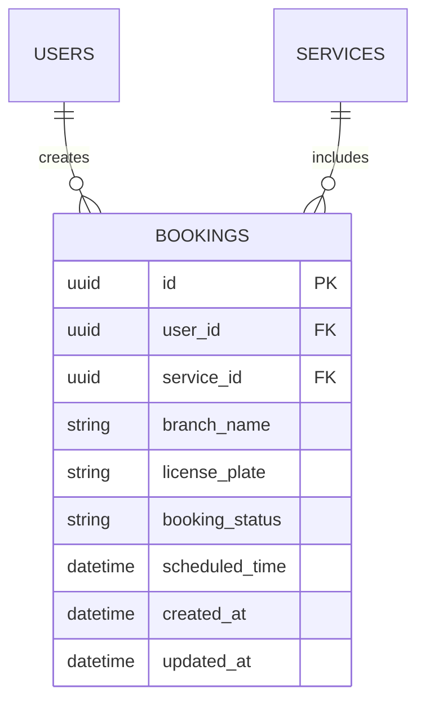

# Kế Hoạch Kỹ Thuật & Hợp Đồng Dữ Liệu MotoCare (Technical Plan)

---
feature_slug: "motocare-booking"
version: "1.0.0"
author: "Technical Planner (tech-planner)"
status: "READY_FOR_DEV"
prd_reference: "docs/specs/motocare-booking/prd.md"
---

## 1. Kiến Trúc & Sơ Đồ ERD


## 2. Ma Trận Hợp Đồng Dữ Liệu Đa Tầng (Cross-Layer Contract Matrix)
> [!IMPORTANT]
> Toàn bộ tên trường bắt buộc phải dùng chuẩn `snake_case` trên cả 3 tầng.

| Tên trường (`snake_case`) | Kiểu DB (SQLAlchemy) | Kiểu Backend (Pydantic v2) | Kiểu Client (TypeScript) | Ràng buộc |
| :--- | :--- | :--- | :--- | :--- |
| `id` | `UUIDPrimaryKeyMixin` | `uuid.UUID` | `string` | Khóa chính tự sinh |
| `user_id` | `Mapped[uuid.UUID]` | `uuid.UUID` | `string` | Foreign key -> `users.id` |
| `branch_name` | `Mapped[str]` | `str = Field(..., min_length=2)` | `string` | Tên chi nhánh phục vụ |
| `license_plate` | `Mapped[str]` | `str = Field(..., min_length=4)` | `string` | Biển số xe |
| `booking_status` | `Mapped[str]` | `str = Field(default="pending")` | `string` | `pending`/`in_progress`/`completed` |
| `scheduled_time` | `Mapped[datetime]` | `datetime` | `string` | Thời gian đặt hẹn |
| `created_at` | `Mapped[datetime]` | `datetime` | `string` | Tự động sinh |

## 3. Đặc Tả REST API Endpoints
- **GET `/api/v1/bookings`**: Lấy danh sách lịch hẹn của user (200 OK)
- **POST `/api/v1/bookings`**: Tạo mới đơn đặt lịch hẹn (201 Created)
- **GET `/api/v1/bookings/{booking_id}`**: Xem chi tiết đơn (200 OK / 404 Not Found)
- **PATCH `/api/v1/bookings/{booking_id}/status`**: Cập nhật trạng thái đơn (200 OK)
- **Error Schema**: `{"detail": "Thông báo lỗi chi tiết"}`

## 4. Dữ Liệu Mẫu Wave 1 Mock Fixtures
```typescript
export const mockBookings = [
  {
    id: "b1c2d3e4-5678-90ab-cdef-1234567890ab",
    user_id: "a1b2c3d4-e5f6-7a8b-9c0d-1e2f3a4b5c6d",
    branch_name: "Chi nhánh Quận 1",
    license_plate: "59-A1 123.45",
    booking_status: "pending",
    scheduled_time: "2026-10-18T10:00:00Z",
    created_at: "2026-10-17T16:00:00Z",
    updated_at: "2026-10-17T16:00:00Z",
  }
];
```
