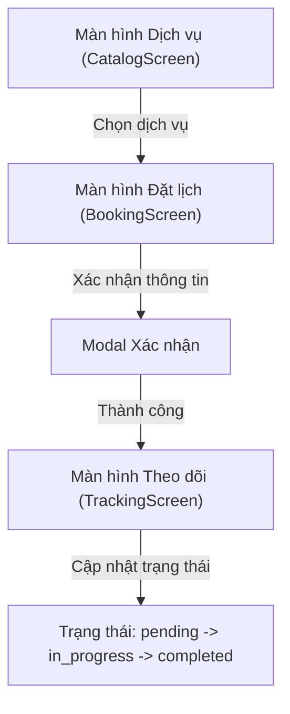

# Đặc Tả Giao Diện & Trải Nghiệm MotoCare Booking (UI/UX Spec)

---
feature_slug: "motocare-booking"
designer: "UI/UX Concept Architect (uiux-designer)"
status: "APPROVED"
---

## 1. Sơ Đồ Luồng Màn Hình (Navigation Flow)

## 2. Quy Chuẩn Design Tokens
- **Primary Brand**: `#2563eb` (Blue 600 - Biểu tượng sự tin cậy kỹ thuật)
- **Status Badges**:
  - `pending`: `bg-amber-100 text-amber-800`
  - `in_progress`: `bg-blue-100 text-blue-800`
  - `completed`: `bg-emerald-100 text-emerald-800`
  - `cancelled`: `bg-slate-100 text-slate-600`

## 3. Ma Trận 5 Trạng Thái Màn Hình (BookingScreen)
| Trạng thái | Giao diện hiển thị |
| :--- | :--- |
| **`default`** | Form điền thông tin xe, chọn dịch vụ và ngày giờ |
| **`loading`** | Skeleton placeholder trong khi tải danh mục dịch vụ |
| **`empty`** | Thông báo "Chưa có dịch vụ nào khả dụng tại chi nhánh này" |
| **`error`** | Alert màu đỏ hiển thị lỗi validation hoặc lỗi kết nối |
| **`success`** | Card hiển thị thông tin đơn đặt lịch thành công kèm mã QR |
