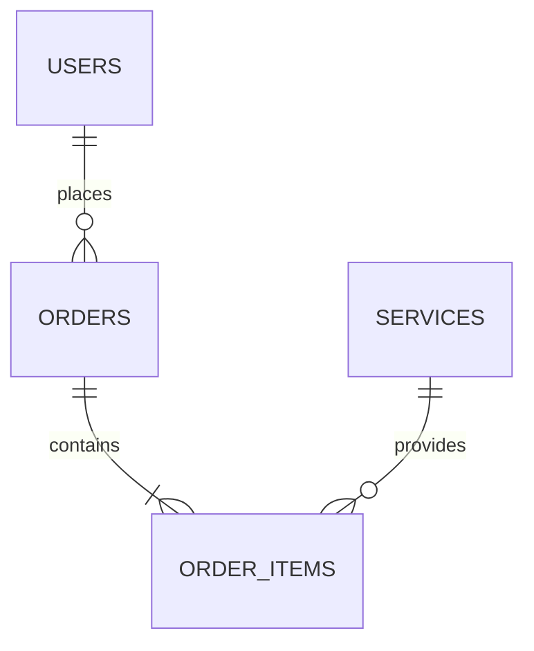

# Kế Hoạch Kỹ Thuật & Hợp Đồng Dữ Liệu (Technical Plan)

---
feature_slug: "<feature-slug>"
version: "1.0.0"
author: "Technical Planner (tech-planner)"
status: "READY_FOR_DEV | IN_PROGRESS | COMPLETED"
prd_reference: "docs/specs/<feature-slug>/prd.md"
---

## 1. Kiến Trúc & Sơ Đồ ERD


## 2. Ma Trận Hợp Đồng Dữ Liệu Đa Tầng (Cross-Layer Contract Matrix)
> [!IMPORTANT]
> Toàn bộ tên trường bắt buộc phải dùng chuẩn `snake_case` trên cả 3 tầng.

| Tên trường (`snake_case`) | Kiểu DB (SQLAlchemy) | Kiểu Backend (Pydantic v2) | Kiểu Client (TypeScript) | Ràng buộc |
| :--- | :--- | :--- | :--- | :--- |
| `id` | `UUIDPrimaryKeyMixin` | `uuid.UUID` | `string` | Khóa chính tự sinh |
| `name` | `Mapped[str]` | `str = Field(..., min_length=1)` | `string` | Bắt buộc |
| `created_at` | `Mapped[datetime]` | `datetime` | `string` | Tự động sinh |

## 3. Đặc Tả REST API Endpoints
- **GET `/api/v1/<resource>`**: Lấy danh sách phân trang (200 OK)
- **POST `/api/v1/<resource>`**: Tạo mới thực thể (201 Created)
- **GET `/api/v1/<resource>/{id}`**: Lấy chi tiết thực thể (200 OK / 404 Not Found)
- **Error Schema**: `{"detail": "Thông báo lỗi rõ ràng"}`

## 4. Dữ Liệu Mẫu Wave 1 Mock Fixtures
```typescript
export const mockItems = [
  { id: "mock-1", name: "Dữ liệu mẫu 1" }
];
```
