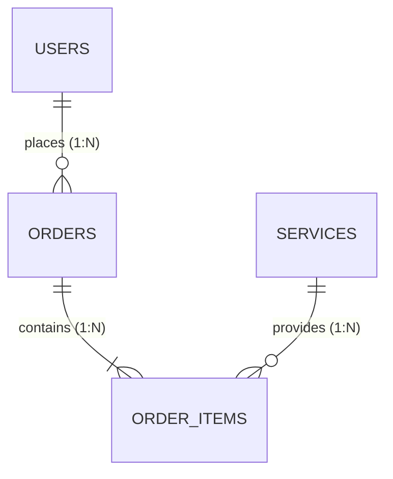

# Technical Specification & Execution Plan: `<Tên Tính Năng>`

> **Tài liệu Single Source of Truth (SSOT)**: Bản đặc tả kỹ thuật và hợp đồng giao tiếp giữa các tầng cho tính năng `<Tên Tính Năng>`. Mọi dev squad (`db-dev`, `backend-dev`, `frontend-dev`) và tester/reviewer (`qa-tester`, `code-reviewer`) bắt buộc tuân thủ hợp đồng này.  
> **Chốt chặn phê duyệt**: **GATE 2: Technical Sign-off** (`review_gate_2_architecture.md`).

---

## 1. Tổng Quan Kiến Trúc & Sơ Đồ Thực Thể (Architecture & ERD)

### 1.1. Mục Tiêu Kỹ Thuật
- Kế thừa Clean Architecture 5 tầng (`models` $\to$ `schemas` $\to$ `repositories` $\to$ `services` $\to$ `routers`).
- Hỗ trợ tương thích chéo 100% giữa SQLite in-memory (Automated tests) và PostgreSQL/Supabase (Production runtime).

### 1.2. Sơ Đồ Quan Hệ Thực Thể (Mermaid ERD)


---

## 2. Ma Trận Hợp Đồng Dữ Liệu Xuyên Tầng (Cross-Layer Contract Matrix)

> [!IMPORTANT]
> **Quy chuẩn Bắt buộc**:
> 1. **Casing chuẩn**: 100% tên trường dùng chuẩn `snake_case` trên cả 3 tầng (Database, Backend API, Frontend/Mobile).
> 2. **UUID**: Sinh tự động tại tầng Python (`default=uuid.uuid4`), serialize sang client dưới dạng chuỗi RFC 4122.
> 3. **Timestamps**: Định dạng ISO 8601 UTC có timezone (ví dụ: `2026-10-02T12:00:00Z`).
> 4. **Mảng dữ liệu**: DB dùng `JSON` chuẩn (hoặc variant `ARRAY`), Backend dùng `list[T]`, Frontend dùng `T[]`.

| Trường Dữ Liệu (`snake_case`) | Kiểu DB (SQLAlchemy 2.0) | Kiểu Backend (Pydantic v2) | Kiểu Client (TypeScript) | Nullable | Mặc định | Ràng buộc & Ghi chú |
| :--- | :--- | :--- | :--- | :---: | :--- | :--- |
| `id` | `UUIDPrimaryKeyMixin` / `Uuid` | `uuid.UUID` / `str` | `string` | Không | `uuid.uuid4` | Khóa chính tự sinh (RFC 4122) |
| `<field_name>` | `Mapped[str]` | `str = Field(..., min_length=1)` | `string` | Không | `...` | Bắt buộc nhập, độ dài tối đa 255 |
| `status` | `Mapped[str]` | `StatusEnum` (StrEnum) | `"PENDING" \| "CONFIRMED"` | Không | `"PENDING"` | String literal union type trên client |
| `metadata` | `Mapped[dict]` (`JSON`) | `dict[str, Any]` | `Record<string, any>` | Có | `dict` | Lưu trữ cấu trúc linh hoạt |
| `created_at` | `Mapped[datetime]` | `datetime` | `string` | Không | `func.now()` | Tự động sinh, ISO 8601 UTC |
| `updated_at` | `Mapped[datetime]` | `datetime` | `string` | Không | `func.now()` | Tự động cập nhật onupdate |

---

## 3. Data Contract — Thiết Kế Cơ Sở Dữ Liệu (`src/db/`)

### 3.1. SQLAlchemy 2.0 Models (`src/db/models/<module>.py`)
- Kế thừa `Base` từ `src.db.base` và `UUIDPrimaryKeyMixin`.
- Đảm bảo khai báo đầy đủ Index cho các cột khóa ngoại và cột lọc tìm kiếm.
- Ngăn chặn triệt để N+1 Query: Sử dụng `selectinload` hoặc `joinedload` trong Repository queries.

### 3.2. Migration & Seed Data
- Tự động sinh migration qua `scripts/generate_offline_migration.py <slug>`.
- Khởi tạo seed data tại `src/db/seeds/<module>_seed.py` phục vụ phát triển cục bộ và kiểm thử độc lập.

---

## 4. API Contract — Đặc Tả REST API Endpoints (`src/backend/`)

### 4.1. Danh Mục Endpoints

| Method | Endpoint Route | Mô Tả Chức Năng | Quyền Hạn (RBAC) | HTTP Status Thành Công |
| :---: | :--- | :--- | :---: | :---: |
| **GET** | `/api/v1/<resource>` | Lấy danh sách thực thể (hỗ trợ phân trang) | Public / User | `200 OK` |
| **POST** | `/api/v1/<resource>` | Tạo mới thực thể | Authenticated User | `201 Created` |
| **GET** | `/api/v1/<resource>/{id}` | Lấy thông tin chi tiết thực thể | Owner / Admin | `200 OK` |
| **PUT** | `/api/v1/<resource>/{id}` | Cập nhật toàn bộ thông tin thực thể | Owner / Admin | `200 OK` |
| **DELETE** | `/api/v1/<resource>/{id}` | Xóa hoặc chuyển trạng thái mềm (Soft delete) | Admin | `204 No Content` |

### 4.2. Chuẩn Hóa Phản Hồi Lỗi (Error Response Standard)
Toàn bộ API endpoints thống nhất cấu trúc lỗi:
```json
{
  "detail": "Thông báo lỗi rõ ràng dành cho người dùng cuối"
}
```

### 4.3. Dữ Liệu Mẫu Wave 1 Mock Fixtures (`src/frontend/src/lib/api/mocks/<resource>.ts`)
```typescript
import { <Resource> } from '@/types/<resource>';

export const mock<Resource>List: <Resource>[] = [
  {
    id: "mock-1111-2222-3333",
    <field_name>: "Giá trị mẫu kiểm thử",
    status: "PENDING",
    created_at: "2026-10-25T10:00:00Z",
    updated_at: "2026-10-25T10:00:00Z"
  }
];
```

---

## 5. UI Architecture & 5 Trạng Thái Giao Diện (`src/frontend/` & `src/mobile/`)

Giao diện Web/Mobile bắt buộc cài đặt đầy đủ **5 trạng thái giao diện**:
1. **Default State**: Giao diện tiêu chuẩn sẵn sàng tiếp nhận tương tác.
2. **Loading State**: Hiển thị Skeleton loaders hoặc Spinner khi gọi API.
3. **Empty State**: Hiển thị hình minh họa và CTA khi danh sách không có dữ liệu.
4. **Error State**: Hiển thị thông báo lỗi thân thiện kèm nút Retry (Thử lại).
5. **Success State**: Phản hồi tức thì (Toast/Banner) và cập nhật dữ liệu vào Store.

---

## 6. Ma Trận Truy Xuất Yêu Cầu 4 Tầng & Kịch Bản Kiểm Thử (4-Tier Traceability Matrix)

| Yêu Cầu PRD (FR-xx) | Tiêu Chí Nghiệm Thu BA (BAC-xx) | Tiêu Chí Kỹ Thuật (AC-xx) | Mã Kịch Bản Test (TC-xx) | Tầng Kiểm Thử | File Kiểm Thử Phụ Trách | Kết Quả Kỳ Vọng |
| :---: | :---: | :---: | :---: | :---: | :--- | :--- |
| **FR-01** | `BAC-01` | `AC-01` | `TC-BE-01` | Backend API | `src/backend/tests/test_<module>.py` | HTTP 201 Created, trả về đúng JSON Schema |
| **FR-01** | `BAC-01` | `AC-01` | `TC-FE-01` | Frontend Unit | `src/frontend/src/__tests__/<module>.test.tsx` | Render form hợp lệ, submit gửi payload snake_case |
| **BR-01** | `BAC-02` | `AC-02` | `TC-BE-02` | Business Logic | `src/backend/tests/test_<module>.py` | Giới hạn slot/bàn, trả về HTTP 400/409 khi vượt quá |
| **BR-01** | `BAC-02` | `AC-02` | `TC-E2E-01` | Full Journey | `src/frontend/scripts/run_e2e_tests.cjs` | Kiểm chứng toàn diện kịch bản end-to-end xuyên suốt |

---

## 7. Phân Rã Nhiệm Vụ Lập Trình 2-Wave (Atomic Execution Tasks)

### 🌊 Wave 1: Triển Khai Song Song (DB & Frontend Mocks)
- [ ] **Task DB-1**: Xây dựng Model SQLAlchemy 2.0 tại `src/db/models/<module>.py`.
- [ ] **Task DB-2**: Tạo migration Alembic và chạy kiểm tra cú pháp AST.
- [ ] **Task DB-3**: Xây dựng Repository cơ bản tại `src/db/repositories/<module>_repo.py`.
- [ ] **Task FE-1**: Khai báo TypeScript types tại `src/frontend/src/types/<module>.ts`.
- [ ] **Task FE-2**: Cài đặt Mock fixtures tại `src/frontend/src/lib/api/mocks/<module>_mock.ts`.
- [ ] **Task FE-3**: Dựng giao diện màn hình xử lý đủ 5 trạng thái giao diện UI.
- [ ] **Wave 1 Handshake Gate**: Chạy `python scripts/verify_contracts.py` đảm bảo 100% khớp nối.

### 🌊 Wave 2: Nối Mạng Live API & DevOps
- [ ] **Task BE-1**: Tạo Pydantic v2 schemas (`Request`, `Response`, `CreatePayload`) tại `src/backend/app/schemas/<module>.py`.
- [ ] **Task BE-2**: Xây dựng Service logic kết nối Repository tại `src/backend/app/services/<module>_service.py`.
- [ ] **Task BE-3**: Mở API endpoints tại `src/backend/app/api/v1/endpoints/` và đăng ký router.
- [ ] **Task FE-4**: Chuyển API Client sang gọi Live API (`NEXT_PUBLIC_USE_MOCKS=false`).
- [ ] **Task DO-1**: Cập nhật Docker Compose và biến môi trường nếu có.

---

## 8. Khai Báo Thư Viện Mới (Dependencies Declaration)
> Nếu không cần thêm thư viện mới, ghi rõ: `Không có thư viện mới phát sinh`.

- **Python (`pyproject.toml`)**:
  - `<package-name>`: Mục đích sử dụng cụ thể. *(Subagent cắm cờ `[DEPENDENCY REQUIRED]` để Tech Lead cập nhật).*
- **Frontend (`package.json`)**:
  - `<package-name>`: Mục đích sử dụng cụ thể.

---

## 9. Nhật Ký Phiên Bản & Đồng Bộ Ngược Hợp Đồng (Revision History & Reverse Sync)

| Phiên Bản | Ngày Cập Nhật | Tác Tử Thực Hiện | Loại Thay Đổi | Tóm Tắt Nội Dung Thay Đổi & Lý Do |
| :---: | :---: | :---: | :---: | :--- |
| `1.0.0` | YYYY-MM-DD | `@tech-planner` | Khởi tạo | Bản thiết kế kiến trúc kỹ thuật ban đầu qua Gate 2 |
| `1.1.0` | YYYY-MM-DD | `@tech-planner` | Reverse Contract Sync | Điều chỉnh schema/API theo yêu cầu phát sinh thực tế từ Dev Squad |
