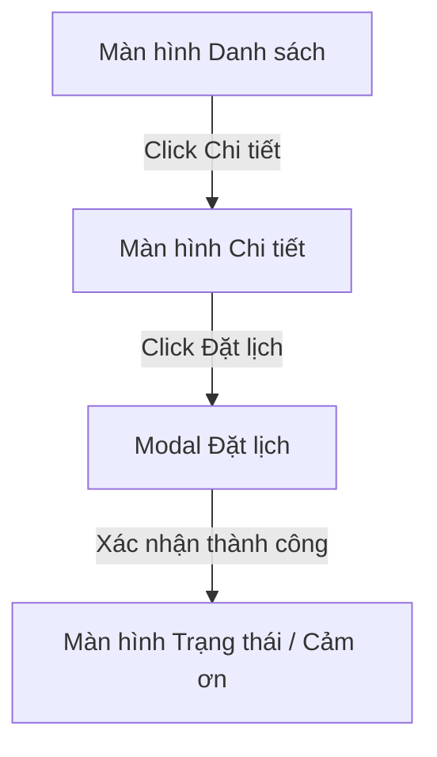

# Đặc Tả Giao Diện & Trải Nghiệm Người Dùng (UI/UX Spec)

---
feature_slug: "<feature-slug>"
designer: "UI/UX Concept Architect (uiux-designer)"
status: "DRAFT | APPROVED"
---

## 1. Sơ Đồ Luồng Màn Hình (Screen Navigation Flow)

## 2. Quy Chuẩn Design Tokens (Tailwind CSS Theme)
- **Primary Color**: `bg-blue-600`, `text-blue-600`, hover `bg-blue-700`
- **Secondary Color**: `bg-slate-100`, text `text-slate-800`
- **Success Color**: `bg-emerald-100`, text `text-emerald-800`
- **Danger Color**: `bg-red-100`, text `text-red-700`
- **Border Radius**: `rounded-xl`
- **Elevation**: `shadow-sm` hover `shadow-md`

## 3. Ma Trận 5 Trạng Thái Giao Diện (5 UI States Matrix)
| Trạng thái | Điều kiện kích hoạt | Hành vi & Giao diện hiển thị |
| :--- | :--- | :--- |
| **`default`** | Khởi tạo ban đầu | Hiển thị giao diện tĩnh sẵn sàng cho người dùng thao tác |
| **`loading`** | Đang gọi API bất đồng bộ | Skeleton Shimmer hoặc spinner tròn |
| **`empty`** | Dữ liệu trả về rỗng (`[]`) | Minh họa Empty State thân thiện kèm nút Call-to-action |
| **`error`** | Request thất bại (4xx, 5xx) | Hộp thoại thông báo lỗi màu đỏ kèm nút "Thử lại" (Retry) |
| **`success`** | Request thành công (200, 201) | Hiển thị danh sách dữ liệu chính xác |
